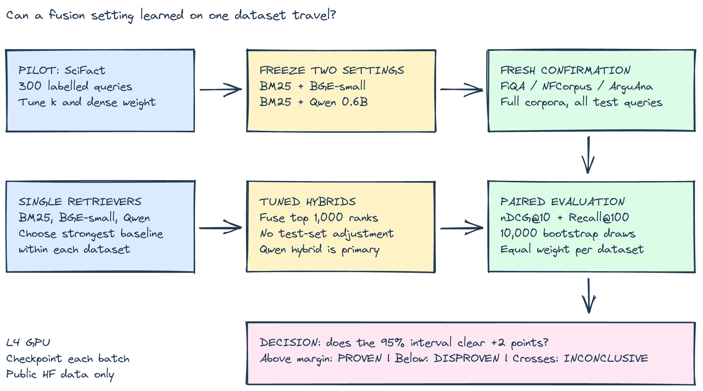
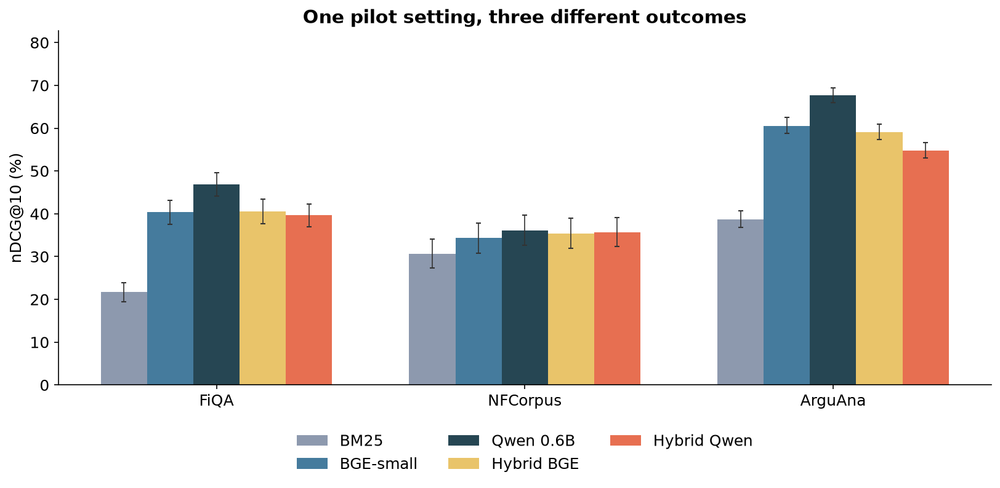
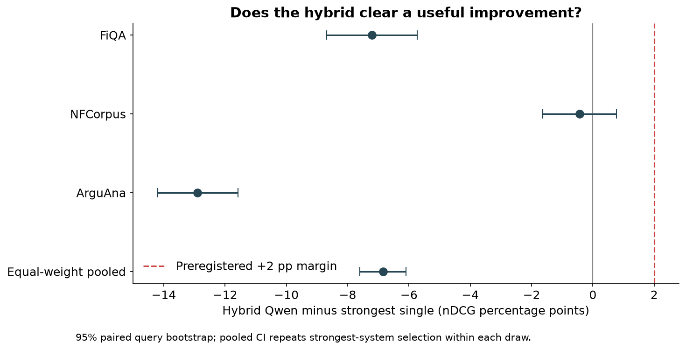
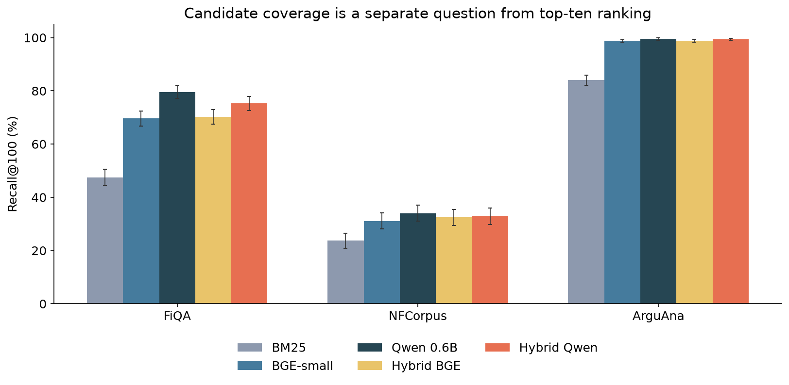

# Tuning hybrid search on SciFact still cost 6.85 points on fresh benchmarks

*A SciFact pilot, two embedding models, and 2,377 fresh BEIR queries.*

You have a working vector search service. Someone suggests adding BM25 and merging the results. The pitch is appealing: exact keywords catch what embeddings miss, while embeddings handle different ways of saying the same thing.

The classic [Reciprocal Rank Fusion paper](https://doi.org/10.1145/1571941.1572114) says combining rankings “consistently yields better results than any individual system.” Its experiments support that claim in their settings. The engineering question is whether a useful improvement survives when your mixture moves to another domain.

**My headline result: -6.85 percentage points of nDCG@10 versus the strongest standalone retriever**, averaged equally across three fresh datasets. The paired 95% confidence interval was -7.61 to -6.10 points. Even the upper endpoint was below the practical margin. The pre-registered hypothesis was DISPROVEN on this benchmark mix.

That verdict concerns a two-point improvement, not every possible use of hybrid search.

## What I tested

This follows [my first SciFact comparison](../original-run/). On SciFact, BGE-small beat basic BM25, but a fixed BM25-plus-MiniLM hybrid failed to beat BGE. This time I used better ingredients and tuned fusion before testing it elsewhere.

The five systems were BM25, [BAAI/bge-small-en-v1.5](https://huggingface.co/BAAI/bge-small-en-v1.5), [Qwen/Qwen3-Embedding-0.6B](https://huggingface.co/Qwen/Qwen3-Embedding-0.6B), and a BM25 hybrid for each embedding model. Qwen's hybrid was the primary hypothesis; BGE's was secondary.

Dense retrieval used normalized embeddings and exact cosine search across full corpora. Both models had a 512-token input cap and retrieval instructions on queries. BGE ran in float32 and Qwen in float16 on an NVIDIA L4. BM25 used rank_bm25 defaults with lowercased word tokens, computed locally on CPU.

SciFact's 300 queries were development data. Confirmation used 648 FiQA queries against 57,638 documents, 323 NFCorpus queries against 3,633 documents, and 1,406 ArguAna queries against 8,674 documents. These public Hugging Face BEIR datasets were not used in that first comparison, though they are not necessarily absent from model training. ArguAna self matches were excluded for every system.

Settings could change on SciFact, but they could not change after seeing the three confirmation datasets. That boundary is the main safeguard against turning benchmark feedback into apparent generalization.

## What tuning actually chose

Reciprocal Rank Fusion combines positions in ranked lists rather than raw BM25 and cosine scores. Its smoothing constant, k, controls how sharply it rewards top positions. A dense weight controls the embedding retriever's share of the combined score.

For each model, I tested four k values and five weights on SciFact, selecting the highest nDCG@10. Fusion considered the top 1,000 results from each component. Both selected k=10. BGE selected an 80% dense weight; Qwen selected 50%.

The tuned Qwen hybrid scored 72.74% on the pilot. The strongest standalone system, BGE, scored 71.27%. The development gain was only 1.47 points, already below the practical threshold. Each model had twenty configurations, giving tuning opportunities to capitalize on noise.

I kept the original hypothesis anyway: the Qwen hybrid would improve by at least two points on fresh data. The margin was an engineering hurdle for maintaining two retrieval paths, not a magnitude established by the paper.

## The fresh results

This chart compares all five systems on nDCG@10, which rewards relevant documents near the top of the first ten results. Error bars represent query-level uncertainty, not uncertainty across future domains.

**FiQA**, covering financial questions, had Qwen 0.6B as its strongest standalone retriever at 46.87% nDCG@10. The Qwen hybrid scored 39.66%, a -7.21-point change, with a paired 95% interval of -8.69 to -5.74 points.

**NFCorpus**, covering medical information needs, had Qwen 0.6B as its strongest standalone retriever at 36.14% nDCG@10. The Qwen hybrid scored 35.71%, a -0.43-point change, with a paired 95% interval of -1.64 to +0.76 points.

**ArguAna**, covering argument matching, had Qwen 0.6B as its strongest standalone retriever at 67.74% nDCG@10. The Qwen hybrid scored 54.83%, a -12.90-point change, with a paired 95% interval of -14.20 to -11.58 points.

The comparator is deliberately demanding: the best of BM25, BGE and Qwen within each dataset, chosen after scoring. It tests the alternative I would want hybrid to beat, rather than comparing only with a weak ingredient.

The dashed line marks the pre-registered two-point margin. The pooled row gives each dataset equal weight, so ArguAna's larger query count cannot dominate the headline.

I used 10,000 paired bootstrap draws, resampling queries within datasets. The primary interval repeats baseline selection in every draw. Dataset intervals hold their observed comparator fixed and are descriptive. PROVEN required the lower endpoint to reach two points; an upper endpoint below two meant DISPROVEN; crossing two meant INCONCLUSIVE.

Recall@100 asks whether relevant candidates were recovered; for Qwen versus its hybrid, it changed as follows: FiQA: 79.6% to 75.3%; NFCorpus: 34.0% to 32.8%; ArguAna: 99.5% to 99.4%. Candidate coverage and top-ten ordering should be evaluated separately.

## What surprised me / what I got wrong

The losses were larger than I expected. On FiQA, fusion improved 105 queries relative to Qwen but hurt 281; on ArguAna, it improved 161 and hurt 684. These are exploratory counts, not another significance test.

The assumption under test was that a better fusion setting learned on scientific claims would deliver a useful gain elsewhere. The pilot gave reason for caution before confirmation: even its selected point estimate missed two points against BGE.

I also couldn't assume the larger embedding model would be the strongest baseline everywhere. That's why the test included both dense models and BM25. Calling an improvement over one ingredient a deployment win would have repeated the comparison mistake in the first version of this experiment.

The committed verdict stays DISPROVEN. A favorable secondary comparison cannot replace the primary test after the results arrive.

## What I would do in production

1. **Establish the strongest feasible standalone baseline.** Include a dense-only fallback in the tuning grid. This grid required at least 20% lexical weight, so it could not choose to switch BM25 off. Compare under identical relevance rules.
2. **Keep development and release tests separate.** Tune on representative development queries, then evaluate untouched queries and domains before shipping the fusion settings.
3. **Track ranking and candidate coverage separately.** More candidates can help a later reranker, but this experiment didn't test one or measure generated-answer quality.
4. **Measure the complete operating cost.** Include lexical indexing, query encoding, both searches and merging. Batch encoding times here don't establish online p95 latency.

## Limitations

This was weighted RRF with two components, not a reproduction of the original paper's collections and system ensembles. BM25 had no stemming, stopword removal or parameter tuning. A stronger lexical implementation could change the result.

The common 512-token cap constrained Qwen's longer-context capability. Different tokenizers also preserve different spans, and the generic query instruction may fit argument matching poorly. Those choices remained fixed through confirmation.

Three datasets cannot represent every production domain. Five ArguAna gold document IDs were missing from the HF corpus. I retained those five queries, which scored zero for every system. Labels are incomplete, query resampling assumes independence, and model training may have included these benchmarks. Exact search also avoids the approximation and scaling choices a larger service would face.

Timing: estimated 100 minutes; actual 229.1 minutes, including the earlier allocation wait and interruption. NVIDIA L4 usage was approximately 0.773 CU, estimated from session duration at 1.54 CU/hour. The detached worker saved checkpoints and the session was stopped after completion.

A fusion setting earns its place by surviving a fresh test. Its pilot score is only the invitation to run that test.

Code: https://github.com/nankris/embeddings-vs-keyword-search/tree/main/hybrid-search-fresh
